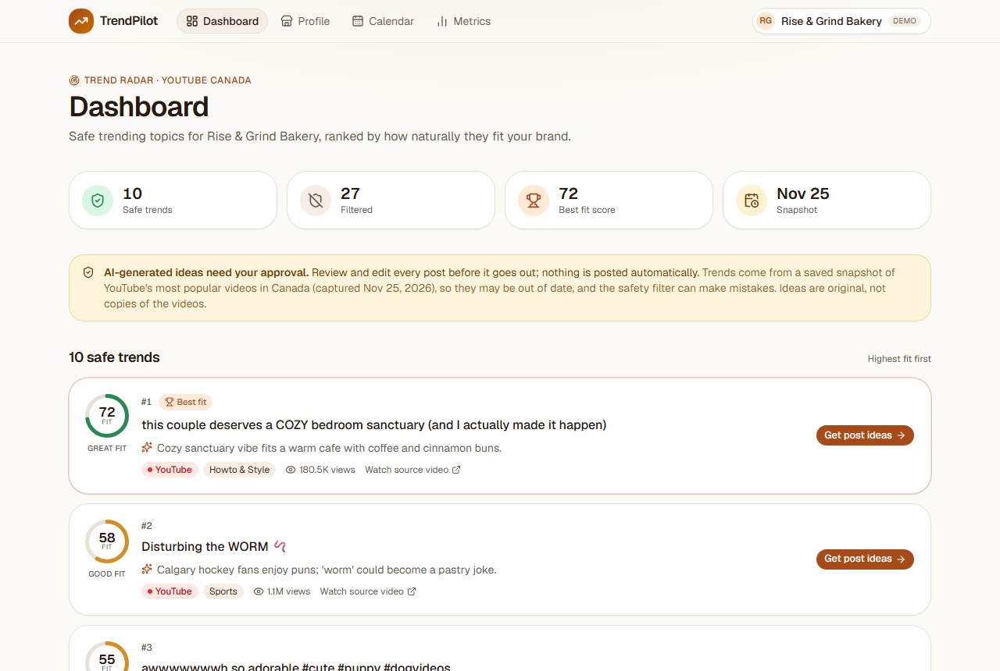
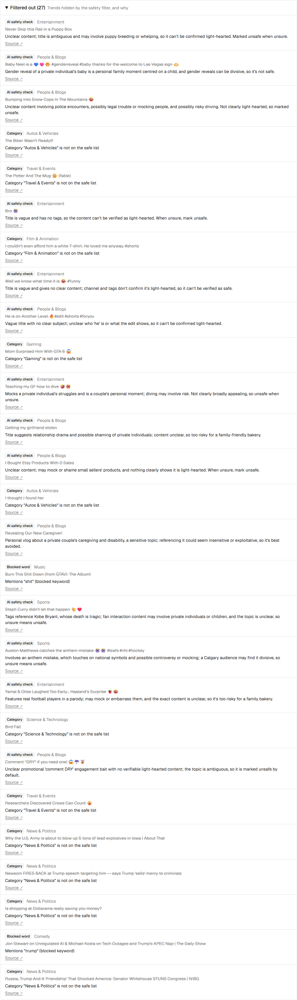
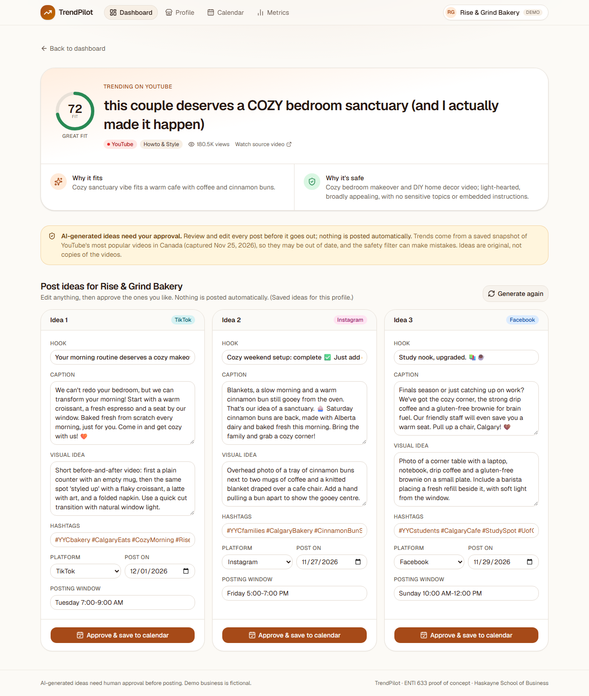
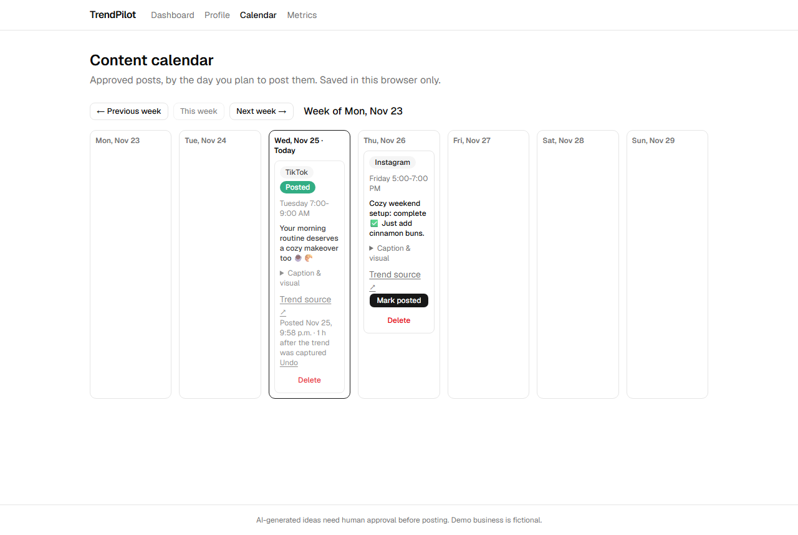
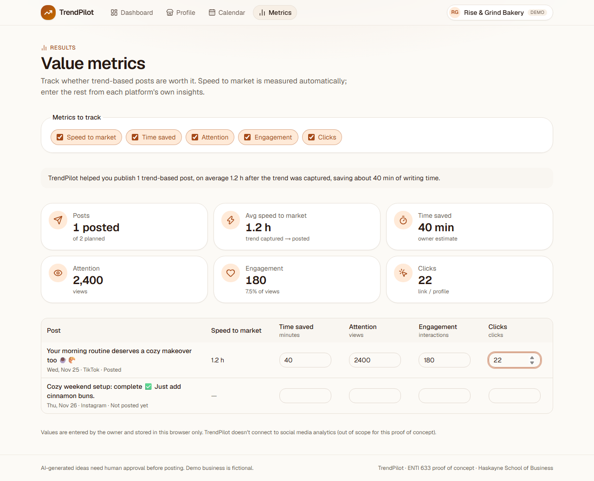
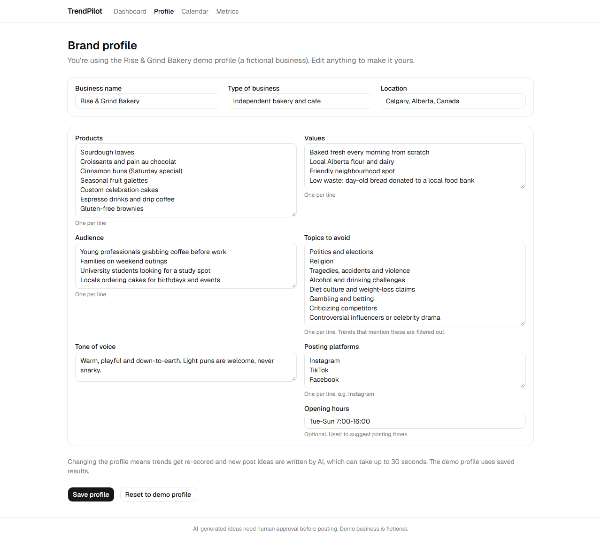
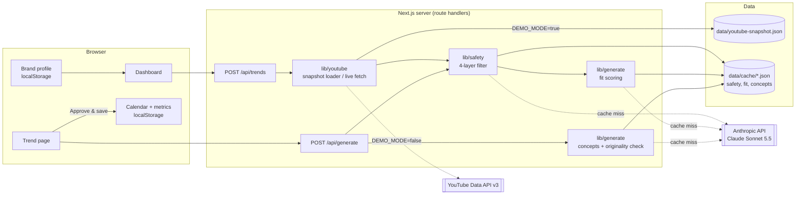

# TrendPilot

**Safe trending topics, turned into post ideas a small business can actually use.**

TrendPilot is a proof of concept built for ENTI 633 (Haskayne School of Business, University of
Calgary). It finds what's trending on YouTube in Canada, filters out anything a family-friendly
brand shouldn't touch, scores each remaining trend for fit with the business, and writes three
original post ideas the owner can edit, approve and schedule.

The demo business is **Rise & Grind Bakery**, a fictional bakery and cafe in Calgary.

**Live demo:** [trendpilot-rho.vercel.app](https://trendpilot-rho.vercel.app/) (deployed on Vercel)



## The problem

Small business owners know trends drive attention, but they don't have time to watch what's
trending, judge whether it's safe for their brand, and turn it into a post while it's still
relevant. Jumping on the wrong trend (a tragedy, a political story) can damage a local brand
overnight. TrendPilot does the watching, filtering and first draft; the owner stays in control of
what gets posted.

On instructor advice, we narrowed the scope to **one platform (YouTube), one industry (a local
bakery/cafe) and safe trends only** (see [docs/decisions.md](docs/decisions.md)).

## Features

| | |
|---|---|
| **Brand profile** | Prefilled for the demo bakery: products, values, tone, audience, platforms, opening hours and topics to avoid. Editable and saved in the browser, with a one-click reset. |
| **Safe trend list** | Trending YouTube videos pass a four-layer safety filter. Each remaining trend gets a **fit score (0–100)** with a one-line reason, a category badge, a link to the source video, and **engagement signals**: velocity (views per hour), engagement rate ((likes + comments) / views) and breakout ratio (views / channel subscribers). |
| **Filtered out panel** | Every excluded trend is listed with the layer that caught it and why, so the filter is transparent. |
| **Post ideas** | Pick a trend to get **3 original post concepts**: hook, caption, visual idea, hashtags, platform and posting window. Every field is editable. |
| **Human approval** | Nothing is posted automatically. "Approve & save to calendar" is the only way a post moves forward. |
| **Content calendar** | Week view of approved posts. Delete, or **Mark posted** to record speed to market. |
| **Value metrics** | Toggle the metrics you care about (speed to market, time saved, attention, engagement, clicks), enter results per post, and see totals plus a one-line value statement. |
| **Works offline for demos** | Runs from a saved YouTube snapshot and cached AI results, so the presentation doesn't depend on any API being reachable. |

## Screenshots

| Filtered out, with reasons | Post ideas, editable |
|---|---|
|  |  |

| Content calendar | Value metrics (sample numbers) |
|---|---|
|  |  |



Screenshots are generated from the running app with `npm run screenshots`.

## How it works



### The safety filter

A trend must pass **all four layers**, in order. Only trends that pass layers 1–3 reach the LLM.

1. **Category allowlist:** Howto & Style, Entertainment, Comedy, People & Blogs, Music, Sports, Pets & Animals. Never News & Politics or Nonprofits & Activism.
2. **Keyword blocklist** ([lib/safety/blocklist.ts](lib/safety/blocklist.ts)): violence, tragedy, politics, legal trouble, profanity.
3. **The profile's topics to avoid**, turned into keywords.
4. **LLM safety check** returning `{ safe, reason }`. **When unsure, it marks the trend unsafe**, and so do errors, timeouts and refusals.

### LLM safeguards

- All LLM calls run server-side only. The API key never reaches the browser.
- Structured JSON output, validated with **zod**, a **30 s timeout**, one retry, and a **friendly error message** in the UI.
- **Prompt-injection defence:** video titles and tags are untrusted. They go only into a delimited `<trend_data>` block with tag characters neutralised, and the system prompt tells the model to treat them as data. The owner's profile gets the same treatment in a `<brand_profile>` block.
- **Originality is enforced in code:** a concept that contains the video's title or names the channel is rejected and regenerated.

### Tech stack

Next.js 16 (App Router, TypeScript), Tailwind CSS 4, shadcn/ui, zod, Anthropic TypeScript SDK,
YouTube Data API v3, Vitest, Playwright. No database: JSON files for trend data and caches,
localStorage for the profile, calendar and metrics.

## Setup

**Requirements:** Node.js 20+ and npm. An Anthropic API key is optional for the demo.

```bash
git clone https://github.com/ckarp333-boop/trendpilot.git
cd trendpilot
npm install
cp .env.example .env.local      # Windows PowerShell: Copy-Item .env.example .env.local
npm run dev                     # open http://localhost:3000
```

With `DEMO_MODE=true` (the default) the app runs entirely from the saved snapshot and cached AI
results. **The demo profile needs no API keys at all.** To edit the profile and get fresh AI
scores and ideas, add `ANTHROPIC_API_KEY` to `.env.local`.

| Variable | Needed for |
|---|---|
| `ANTHROPIC_API_KEY` | Live AI for an edited profile, and the `cache:*` scripts ([console.anthropic.com](https://console.anthropic.com)) |
| `YOUTUBE_API_KEY` | `DEMO_MODE=false` and `npm run fetch:youtube` ([Google Cloud Console](https://console.cloud.google.com), a "Public data" API key) |
| `DEMO_MODE` | `true` = saved snapshot, no YouTube calls (default) |
| `ANTHROPIC_MODEL` | Model ID, default `claude-sonnet-5-5` |

### Scripts

| Command | What it does |
|---|---|
| `npm run dev` | Start the dev server |
| `npm run lint` | ESLint |
| `npm test` | Vitest unit tests |
| `npm run test:e2e` | Playwright end-to-end tests (builds and starts the app; run `npx playwright install chromium` once first) |
| `npm run build` | Production build |
| `npm run screenshots` | Regenerate the README screenshots |
| `npm run fetch:youtube` | Refresh the YouTube snapshot (needs `YOUTUBE_API_KEY`) |
| `npm run refresh:stats` | Refresh only the counts (views, likes, comments, subscribers) for the videos already in the snapshot. Titles stay the same, so cached AI results stay valid (2 quota units) |
| `npm run cache:safety` | Re-run the AI safety check on the snapshot and save verdicts (needs `ANTHROPIC_API_KEY`) |
| `npm run cache:generate` | Re-generate demo fit scores and post ideas (needs `ANTHROPIC_API_KEY`) |

After refreshing the snapshot, run `cache:safety` and then `cache:generate` so the demo works offline.

## Test evidence

- **177 unit tests** (Vitest): safety layers, engagement signals, prompt injection, schema validation, retries and timeouts with a mocked LLM, API error handling, snapshot loading, metrics.
- **8 end-to-end tests** (Playwright), including the full **profile → trend → generate → save → calendar** flow, run with the AI key blanked to prove the demo works from cached results.
- **Live LLM runs:** the safety filter kept 12 of 38 trending videos and caught **both prompt-injection probes**. Fit scores ranged from 8 to 62.

Full output and details are in [docs/test-evidence/](docs/test-evidence/README.md).

## Known limitations

- **Snapshot, not live:** the demo uses YouTube's most-popular chart for Canada captured on 2026-11-28 (UTC). Trends go stale quickly; refreshing the trend list needs a YouTube key and two cache scripts.
- **YouTube's category filter is loose:** some videos arrive in categories we didn't request. We use each video's own category, so the allowlist still applies correctly.
- **The safety filter is deliberately cautious.** Keywords can't read context (for example "Attacking the weekend" is blocked), and the AI rejects vague titles. Only 12 of 38 trends survive. It can still make mistakes, which is why every post needs human approval.
- **Engagement signals are rough guides.** They are simple maths on public counts, shown next to the fit score but not used in the ranking. The highlight thresholds (100K views/hr, 4% engagement, 10× reach) are rules of thumb, not benchmarks. YouTube rounds subscriber counts, and some creators hide likes.
- **Fit scores and ideas are AI-generated** and can be generic or miss local nuance. They're starting points, not finished posts.
- **One industry, one platform:** prompts and the demo profile are tuned for a bakery/cafe and YouTube trends.
- **Browser-only storage:** the profile, calendar and metrics live in this browser's localStorage. There's no login, no sync between devices, and clearing site data erases them.
- **Metrics are owner-entered;** there's no connection to Instagram, TikTok or Facebook analytics.
- **An edited profile means live AI calls** (about 10–30 seconds, and API cost). Only the demo profile has cached results.
- **Theme follows the system setting** (light or dark); there's no manual toggle.

## Data sourcing disclaimer

- **Trend data** comes from the public **YouTube Data API v3** (`videos.list`, `chart=mostPopular`, `regionCode=CA`). We store only each video's title, channel name, category, view, like and comment counts, publish date, link and up to 10 tags, plus the channel's public subscriber count (from `channels.list`; the channel ID is used for the lookup and then dropped). **@mentions of individuals are stripped.** No descriptions, comment text, thumbnails or viewer data are collected. Video titles and channel names belong to their creators and are shown only to identify the trend and link to its source.
- TrendPilot is **not affiliated with or endorsed by YouTube or Google.** Use of the API is subject to the YouTube API Services Terms of Service.
- **Rise & Grind Bakery is fictional.** All profile details, test fixtures and sample metrics are synthetic. No real customer or personal data is used.
- Generated post ideas are original text that references only a trend's general theme. They do not copy titles, creators' content, lyrics or trending audio.

## AI-use disclosure

- **In the product:** TrendPilot uses **Anthropic's Claude Sonnet 5.5** (via the Anthropic API) for the safety check, fit scoring and post ideas. All AI output is labelled as AI-generated and requires human approval before use.
- **In development:** the team used **Claude Code** (Anthropic's coding assistant) to scaffold the app, write code and tests, run the build and tests, and draft documentation, working milestone by milestone from our build plan ([BUILD_PLAN.md](BUILD_PLAN.md)) and project rules ([CLAUDE.md](CLAUDE.md)). Team members set the scope and requirements, reviewed and merged every pull request, made the product decisions, and tested the app.
- Prompts that shaped the product are logged in [docs/prompt-log.md](docs/prompt-log.md). Problems and fixes are in [docs/dev-log.md](docs/dev-log.md). Scope and design decisions are in [docs/decisions.md](docs/decisions.md).

## Team contribution statement

*Each team member: replace the placeholder with a sentence or two on what you did.*

| Team member | Contributions |
|---|---|
| Christopher Henry | _To be completed by Christopher_ |
| Conor Karperien | _To be completed by Conor_ |
| Eric Pryor | _To be completed by Eric_ |
| Jett Tuchscherer | _To be completed by Jett_ |

## Licence

MIT. See [LICENSE](LICENSE).
